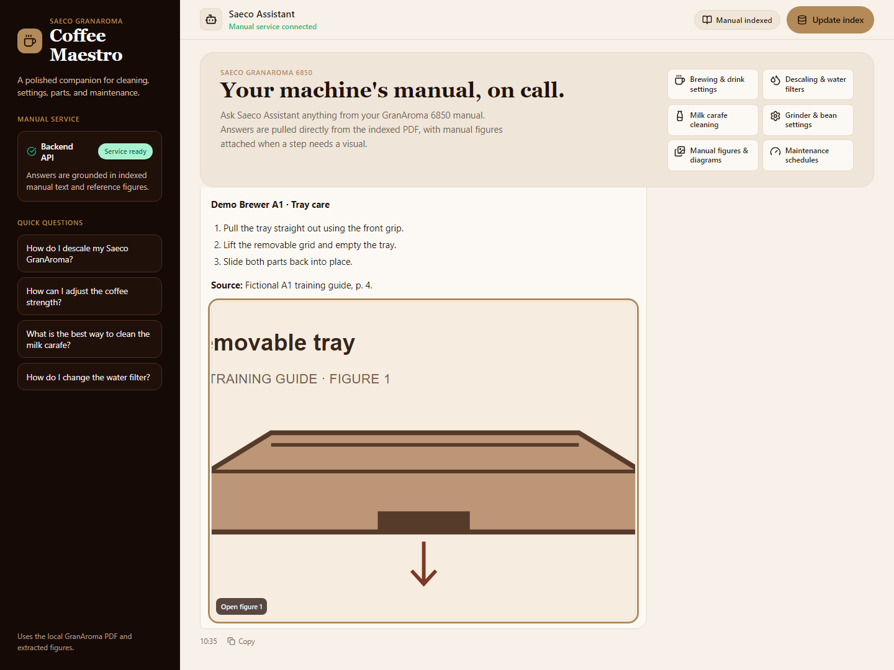
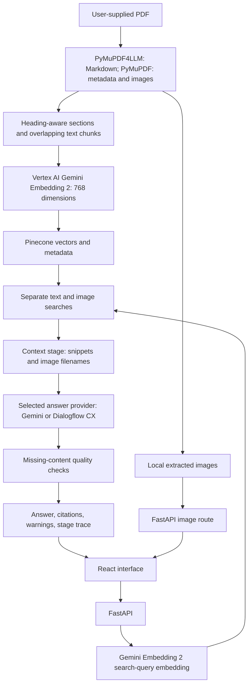

# Coffee Maestro

A multimodal RAG assistant for the Saeco GranAroma 6850 manual, built with Vertex AI Gemini Embedding 2, Pinecone, a configurable answer provider, FastAPI, and React.

## Demo



The React interface is running against a synthetic API fixture. Codex wrote the example answer and figure for a fictional brewer. The capture contains no manufacturer manual pages, device photography, or live cloud output.

## What it does

Coffee Maestro answers natural-language questions about operating and maintaining a coffee machine using retrieved manual passages, page references, and related images. It helps users find instructions without searching the PDF page by page. The application runs locally, while embedding, persistent retrieval, and generation use cloud services.

## Workflow and architecture



PDF text is converted to Markdown, split at headings, then split into configurable overlapping chunks. Gemini Embedding 2 creates 768-dimensional text and image vectors. The [pipeline stages](backend/agents/multi_agent_rag.py) execute sequentially; only synthesis calls a generative model. Images participate in retrieval and display, but the selected synthesis provider receives textual evidence and image references, not diagram pixels. Retrieved text is sent in full by default (`CONTEXT_SNIPPET_MAX_LENGTH=0`). The API returns citation metadata, warnings, and a stage trace; the UI displays the answer and images.

## Prerequisites and quick start

- Python 3.11, matching the existing CI and Dockerfile.

- Node.js 22.12 or newer in the Node 22 line, with npm, following [Vite's requirements](https://vite.dev/guide/).

- For full functionality, supply a manual you are authorized to process, a Google Cloud project with Vertex AI access, and a Pinecone API key. The default Gemini answer provider also needs a Google AI Studio API key. The optional Dialogflow CX provider uses ADC and a configured agent environment.

- Gemini Embedding 2 uses `EMBEDDING_LOCATION=global` by default; supported endpoint locations are `global`, `us`, and `eu`. `GCP_LOCATION` remains a separate setting.

- Your own legally obtained Saeco GranAroma 6850 manual. The PDF and extracted images are excluded from the publication copy and are not covered by this project's MIT license.

Use **Windows PowerShell**, initially at the project root. Copy environment examples only on a fresh checkout; do not overwrite populated files.

### Install and configure

```powershell

cd backend

py -3.11 -m venv venv

.\venv\Scripts\python.exe -m pip install -r requirements.txt

copy .env.example .env

notepad .env

```

Fill in the backend example before running live ingestion or asking questions. Generate `API_SECRET_KEY` with the command in the template. For live access, use your [Pinecone API key](https://docs.pinecone.io/admin/projects/manage-api-keys), Google Cloud project ID, and a [Google AI Studio API key](https://aistudio.google.com/apikey) when using the default Gemini provider.

- Set up [Application Default Credentials](https://docs.cloud.google.com/docs/authentication/provide-credentials-adc) with `gcloud auth application-default login`, or set `GOOGLE_APPLICATION_CREDENTIALS` to an authorized service-account JSON outside the repository. The identity needs Vertex AI access for embeddings. The Conversation provider additionally needs permission to invoke the configured Dialogflow CX agent.

The backend requirements include the [Google Gen AI SDK](https://github.com/googleapis/python-genai), imported as `google.genai`; install the complete manifest with the command above.

```powershell

cd ../frontend

npm ci

copy .env.example .env

npm run build

cd ..

```

Leave `VITE_API_BASE_URL` blank for the backend-served build. Frontend configuration is public: never put credentials there.

### Start the server

```powershell

cd backend

.\venv\Scripts\python.exe main.py

```

Open http://127.0.0.1:8000. The backend serves the built frontend and opens a browser automatically. Keep this terminal open. `/health` checks process availability only, not credentials or indexed data.

The optional root launcher, `python start_app.py`, is Windows-specific and stops existing processes listening on port 8000. Its interpreter precedence is `COFFEE_MAESTRO_PYTHON` in the launching shell, `python_executable` in the ignored root `launcher.runtime.json`, `backend/venv/Scripts/python.exe`, then system Python. The local runtime file is not tracked and contains no credentials. To override it for one launch:

```powershell

python -m pip install -r backend/requirements.txt

$env:COFFEE_MAESTRO_PYTHON = 'C:\path\to\external-runtime\Scripts\python.exe'

python start_app.py

Remove-Item Env:COFFEE_MAESTRO_PYTHON

```

Install `backend/requirements.txt` into the selected external runtime first. The shell override takes precedence over the local runtime file. The direct command above runs the executable you specify.

### Supply and ingest your manual

In another terminal at the project root:

```powershell

New-Item -ItemType Directory -Force data

```

Place your own manual at `data/manual.pdf`; no manual is distributed or downloaded by this project. Submit it to the existing API:

```powershell

$localApiSecret = Read-Host 'Enter your configured API_SECRET_KEY'

Invoke-RestMethod -Method Post -Uri 'http://127.0.0.1:8000/api/ingest' -Headers @{ 'X-API-Key' = $localApiSecret } -ContentType 'application/json' -Body '{"filepath":"../data/manual.pdf"}'

Remove-Variable localApiSecret

```

Paths resolve relative to the backend and must stay within the project. Ingestion sends text and images to Vertex AI and stores vectors and content metadata in Pinecone. Generated images remain in ignored `backend/extracted_images/`. Supply content you have permission to process through these services.

The UI indexing button and [trigger_ingest.py](backend/trigger_ingest.py) instead use the fixed default filename `Saeco GranAroma 6850.pdf` at the project root. Supply your own manual at that ignored path to use them. The script requires the API secret in its shell environment; it does not load the backend environment file itself:

```powershell

cd backend

$env:API_SECRET_KEY = Read-Host 'Enter your configured API_SECRET_KEY'

.\venv\Scripts\python.exe trigger_ingest.py

Remove-Item Env:API_SECRET_KEY

```

Ingest before asking questions. Re-ingestion clears the index's default namespace and replaces its contents; deterministic vector IDs are used. Each ingest currently replaces the active dataset, so use this setup for one manual at a time. The reset API with `confirm=true` also deletes all vectors in that namespace; use a dedicated index.

### Development and keyless verification

For frontend development, set `VITE_API_BASE_URL=http://127.0.0.1:8000` in the frontend environment file and run `npm run dev` from that directory, with the backend running separately. Restart Vite after configuration changes; rebuild before using the backend-served UI. No Vite API proxy is configured.

Without cloud keys, the server can start and serve `/health` because clients initialize lazily. Do not call live ask or ingest endpoints with placeholder keys. Pinecone's in-memory fallback does not replace cloud embedding or generation.

In a fresh checkout, run existing mocked tests and frontend checks:

```powershell

cd backend

$env:API_SECRET_KEY = 'local-test-placeholder'

$env:RUN_LIVE_RAG_TESTS = '0'

.\venv\Scripts\python.exe -m pytest -q

Remove-Item Env:API_SECRET_KEY

Remove-Item Env:RUN_LIVE_RAG_TESTS

cd ../frontend

npm run lint
npm test
npm run build

```

Tests use a dummy server secret. The manual-specific tests are skipped when the caller-supplied PDF is absent. To run the live smoke test, use a configured local environment and ingested manual, then set `RUN_LIVE_RAG_TESTS=1`.

## Answer provider configuration

The public template uses `ANSWER_PROVIDER=gemini`. For the managed option, configure your own published Dialogflow CX environment and set `ANSWER_PROVIDER=vertex_conversation` along with the project, location, agent, and environment values below. Configure an event called `RAG_ANSWER` and bind the generator arguments to `$session.params.question` and `$session.params.manual_evidence`. See the [generator prompt](backend/conversation/generator_prompt.txt) for the evidence contract.

Each answer uses a fresh session. The adapter caps the serialized request at 16,384 UTF-8 bytes by default and returns HTTP 413 for oversized requests before calling the provider. That is an application setting. Synthesis receives retrieved text and image references. Images are delivered separately to the browser. You can switch providers without rebuilding the index.

## Configuration

[config.py](backend/config.py) loads `backend/.env`; Vite reads `frontend/.env`. Run local commands from the backend directory. See the [backend example](backend/.env.example) and [frontend example](frontend/.env.example) for acquisition instructions.

| Variable | Purpose | Required? |
| --- | --- | --- |
| `API_SECRET_KEY` | Server secret; supplied as `X-API-Key` for non-local requests | Yes for protected routes, including local use |
| `ANSWER_PROVIDER` | Synthesis provider (`gemini` or `vertex_conversation`) | Defaults to `gemini` |
| `GOOGLE_API_KEY` | Gemini Developer API generation | Required only for `ANSWER_PROVIDER=gemini` |
| `GCP_PROJECT_ID` | Vertex AI project | Yes for documented cloud setup |
| `GCP_LOCATION` | Existing general Vertex AI region setting | Optional; `us-central1` |
| `CONVERSATION_PROJECT_ID` | Conversation agent project; falls back to `GCP_PROJECT_ID` | Required only for Conversation unless fallback is set |
| `CONVERSATION_LOCATION` | Dialogflow CX agent region, separate from embedding location | Required only for Conversation |
| `CONVERSATION_AGENT_ID`, `CONVERSATION_ENVIRONMENT_ID` | Explicit Dialogflow CX agent and published environment IDs | Required only for Conversation |
| `CONVERSATION_LANGUAGE_CODE`, `CONVERSATION_EVENT_NAME` | DetectIntent language and configured custom event | Optional; `en`, `RAG_ANSWER` |
| `CONVERSATION_TIMEOUT_SECONDS` | DetectIntent deadline | Optional; `30` |
| `CONVERSATION_MAX_PAYLOAD_BYTES` | Serialized-request ceiling enforced by the app | `16384`; one-byte-over is rejected locally with HTTP 413 |
| `GOOGLE_APPLICATION_CREDENTIALS` | External service-account JSON path | Optional with working Application Default Credentials |
| `GEMINI_MODEL` | Gemini model identifier | Optional; `gemini-2.5-flash` |
| `EMBEDDING_MODEL` | Vertex AI embedding model | Optional; `gemini-embedding-2` |
| `EMBEDDING_LOCATION` | Gemini Embedding 2 endpoint location | Optional; `global` (`global`, `us`, or `eu`) |
| `EMBEDDING_DIMENSIONS` | Embedding and Pinecone vector dimensions | Optional; `768` |
| `PINECONE_API_KEY` | Persistent vector database access | Yes for persistent retrieval; absent selects memory fallback |
| `PINECONE_INDEX_NAME` | Dedicated vector index | Optional; `google-rag-index` |
| `CHUNK_SIZE`, `CHUNK_OVERLAP`, `MIN_CHUNK_SIZE` | Heading-aware text chunking limits, in characters | Optional; `1500`, `200`, `50` |
| `CONTEXT_SNIPPET_MAX_LENGTH` | Context characters per text match; `0` means no truncation | Optional; `0` |
| `TEXT_TOP_K`, `IMAGE_TOP_K` | Text and image retrieval counts | Optional; `7`, `3` |
| `INGEST_BATCH_SIZE` | Pinecone upsert batch size | Optional; `50` |
| `MIN_IMAGE_SIZE_BYTES`, `DIAGRAM_CAPTURE_PAGES` | Image extraction thresholds and page count | Optional; `20000`, `8` |
| `RUN_LIVE_RAG_TESTS` | Live cloud test switch | Optional; set `1` in shell to enable |
| `VITE_API_BASE_URL` | Browser-facing backend URL | Optional; blank for same origin |

Placeholders are not valid credentials. Model availability depends on provider accounts. Other settings and their defaults are documented in [`backend/.env.example`](backend/.env.example).

Pinecone index dimensions cannot be changed in place. For the 768-dimensional model, use a fresh `PINECONE_INDEX_NAME`; this preserves an existing 1408-dimensional index. Delete the old index only if you deliberately choose that cleanup after validating the replacement.

## Failure handling

- Ingestion and reset are mutually exclusive within one backend process. An overlapping mutation returns HTTP 409 immediately with a retry message. Reset does not cancel ingestion; deploy a single worker unless shared coordination is added.

- Ingestion writes images into a unique generation directory. Older images remain available, including after a failed replacement. Old and failed generations are retained; cleanup must account for stored vector references and in-flight responses.

- Queries remain available during delete/upsert and can observe intermediate data. This writer guard does not make Pinecone replacement transactional.

- Ingest rejects paths outside the workspace and non-PDF paths with HTTP 400, and missing files with 404.

- Extraction and embedding complete before the active dataset is cleared, so those failures preserve existing vectors. Pinecone upsert failure after clearing can leave a partial replacement. Vectors are upserted in batches configured by `INGEST_BATCH_SIZE` (default 50).

- Outer ingestion and answer-generation errors return HTTP 502. Successful ingestion reports the upsert count and document metadata summary.

- Missing server `API_SECRET_KEY` returns 500; invalid non-local credentials return 403. Recognized local requests bypass the supplied-key check only when a server secret is configured.

- SlowAPI rate limiting is configured with a default of 10 requests/minute per IP and a reset-specific decorator; effective route limits have not been verified here.

- Missing local images are omitted from assembled context. Quality warnings flag missing answers, context, or citations; they do not block, validate, or repair answers.

- The UI polls health, shows a generic answer-error message, and displays ingestion errors. There is no automatic generation retry.

## Key decisions and tradeoffs

- **Shared embedding space:** Vertex AI `gemini-embedding-2` embeds text and images into a shared space; Pinecone uses 768-dimensional cosine vectors by default. A missing index is created on AWS `us-east-1`, introducing a second cloud alongside Google Cloud.

- **Separate retrieval:** Seven text and three image matches are requested, deduplicated, and sorted, reserving capacity for diagrams.

- **Heading-aware chunks:** PDF-to-Markdown conversion preserves document structure; heading splits are followed by recursive size and overlap splits. Default text chunk size is 1500 characters with 200 characters of overlap.

- **Full context by default:** Retrieved text is not truncated unless `CONTEXT_SNIPPET_MAX_LENGTH` is set above zero.

- **Image selection:** The first eight pages are rendered; embedded images under 20,000 bytes are skipped. Small useful diagrams may be omitted.

- **Local serving:** FastAPI serves React and image files. Stored image metadata contains local paths, so moving the installation can break references.

- **Sequential stages:** Separate retrieval, context, synthesis, and quality classes support testing and inspection; this is not a parallel autonomous-agent system.

- **Memory fallback:** Pinecone-free vector tests are possible, but fallback data disappears on process exit.

I chose shared text-and-image embeddings because the central requirement was to retrieve useful diagrams alongside written instructions. The original decision log records Vertex AI's `multimodalembedding@001` and a text-only alternative, `text-embedding-004`. Text-only retrieval would have required a separate way to find diagrams. The current implementation uses Gemini Embedding 2, retains separate searches to reserve places for visual evidence, and uses Pinecone for persistence. The in-memory store supports development and loses its contents when the process exits.

I kept retrieval and evidence assembly in FastAPI when evaluating Dialogflow CX for synthesis. The managed generator and direct Gemini path share the same answer contract. Configured provider failures surface to the caller, which makes it possible to distinguish a provider failure from an answer generated by a silent fallback. Serving the built React app from the local API keeps setup to one process and keeps provider keys on the server.

## How this was built

I directed the work around a concrete requirement: a local assistant that answers from the supplied manual and can attach the relevant figures. I selected and supplied the existing Conversation agent for the managed-provider evaluation, with local retrieval and an explicit Gemini rollback. I set the review and acceptance criteria around grounded citations, refusal when evidence is missing, valid image links, isolation between concurrent requests, and launch behavior. I also ran live acceptance cases in the private deployment. This public export has a separate, keyless verification run. Codex prepared the publication checks and the synthetic demo.

## Limitations and next steps

- Local prototype: the API-key bypass requires both a loopback peer and a loopback request host. Review security before public hosting; image routes are not API-key protected and exception responses can reveal implementation details.

- Generated citations are prompted, not fact-checked. There are no established accuracy, latency, or business-impact measurements.

- Live cloud ingestion and answer verification for this public checkout are pending. CI uses synthetic PDFs, provider doubles, and a keyless startup check. Live use requires authorized credentials, model access, quota, and billing.

- Ingestion currently replaces the active default-namespace dataset, so documents are not isolated from one another. No OCR pipeline or persistent chat history is implemented. Prompts and UI remain Saeco-specific.

- Python resolves dependencies from the current package index at install time. The optional Windows executable builder is experimental.

GitHub Actions runs the frontend build, tests, lint and dependency audit, the keyless Python test suite, and a container startup check. Use the native quick-start commands for the browser workflow. The demo uses an original figure. The Saeco name identifies the manual the application was designed for.

The [MIT license](LICENSE) covers project code. The manufacturer manual and extracted artwork are excluded from this repository.
